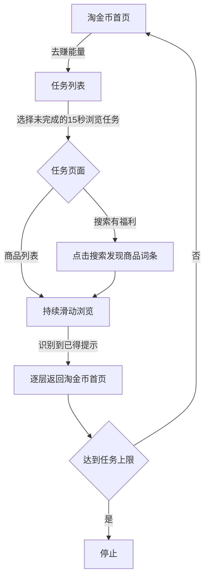

# Harmony Tao Energy

**通过 USB 连接鸿蒙手机，自动执行淘宝淘金币中的 15 秒商品浏览任务。**

这是一个运行在 Windows 电脑上的辅助工具：使用 HDC 操作手机，结合控件树与本地 OCR 识别页面，在浏览过程中持续滑动商品列表。每项任务完成后，统一返回淘金币首页，再进入「去赚能量」任务列表开始下一项。

无需安装额外手机 App，无需修改淘宝，也无需配置云端 OCR 或 API Key。

> 当前版本 **0.3.0**，仍在适配阶段。20 项离线测试已通过，最新返回首页流程仍需更多真机连续运行反馈。淘宝页面改版、设备差异或网络弹窗可能导致识别停止。

## 功能

- **自动导航**：识别「领淘金币」「去赚能量」入口，也可直接从任务列表启动。
- **筛选浏览任务**：按任务行匹配「浏览15秒」与「去完成」，跳过次数已满、邀请、积分兑换和小游戏任务。
- **持续滑动**：向上滑动屏幕，让下方商品进入视野，等待淘宝的完成提示。
- **处理搜索中间页**：遇到「搜索有福利」，选择「搜索发现」区域的商品词条后继续浏览。
- **每轮返回首页**：逐层返回淘金币首页，再打开任务列表，不使用「下个任务」快捷按钮。
- **本地操作面板**：连接检测、开始/停止、任务上限、运行时限、手机预览和日志。
- **异常停止**：遇到登录、验证、超时、未知页面或任务进度持续不变时停止。

完成状态以淘宝顶部的「已得」提示为准，不会仅凭本地计时认定奖励到账。面板计数表示本轮识别到的完成次数。

## 环境要求

| 项目 | 要求 |
| --- | --- |
| 电脑系统 | Windows，支持 Windows Runtime OCR |
| Node.js | 22 或更新版本；开发环境使用 24 |
| 调试工具 | HDC，可从 DevEco Studio SDK 获取 |
| 手机连接 | USB 数据线，开启 USB 调试并允许电脑调试 |
| OCR 语言 | Windows 简体中文 OCR 组件 |
| 手机状态 | 登录淘宝、解锁、竖屏、淘宝保持前台 |

项目没有第三方 npm 运行依赖，不需要执行 `npm install`。

### 兼容性

开发与问题复现参考设备：**HUAWEI Pura 90 Pro Max / HarmonyOS 7.0.0.111 SP12 / API 26 / 1308×2880**。已收到该设备的真实运行日志和页面反馈。

滑动位置依据实际截图尺寸计算，但不代表已适配所有分辨率、系统及淘宝版本。HDC 和 UITest 能力取决于设备系统与调试权限，具体支持情况以真机测试为准。

## 快速开始

### 1. 获取代码

```powershell
git clone https://github.com/894777390/harmony-tao-energy.git
cd harmony-tao-energy
```

也可以选择仓库页面的 **Code → Download ZIP**，解压后运行。

### 2. 连接手机并配置 HDC

安装 Node.js 和 DevEco Studio SDK 中的 HDC。手机开启开发者选项和 USB 调试，通过支持数据传输的 USB 线连接电脑，并在手机提示中允许电脑调试。当前只支持连接一台设备。

程序依次查找以下位置：

1. 环境变量 `HDC_PATH` 指定的可执行文件；
2. C 盘或 D 盘的 `Program Files/Huawei/DevEco Studio/sdk/default/openharmony/toolchains/hdc.exe`；
3. 系统 `PATH` 中的 `hdc`。

如果安装在其他目录，可在 PowerShell 中指定实际路径：

```powershell
$env:HDC_PATH = 'C:\Tools\hdc.exe'
& $env:HDC_PATH list targets
```

应能看到手机设备编号。显示 `[Empty]` 时，请先检查数据线、USB 调试和手机授权提示。

### 3. 启动工具

双击 **`启动工具.cmd`**，或在项目目录运行：

```powershell
npm start
```

打开 <http://127.0.0.1:17883>。

通过 PowerShell 设置 `HDC_PATH` 时，请在同一个窗口运行 `npm start`，让程序继承配置。

### 4. 开始任务

1. 解锁手机并打开淘宝，建议进入「领淘金币 → 去赚能量 → 做任务赚能量」。
2. 点击电脑面板的 **检测连接**，核对画面和识别结果。检测只读取页面，不会点击或滑动。
3. 设置本轮任务数与最长运行时间，点击 **开始**。
4. 运行期间保持淘宝前台，避免同时手动操作手机。

点击 **停止** 可取消后续操作；已发送给手机的单次触摸操作可能仍会完成。退出时，先停止，再在启动窗口按 `Ctrl+C`。

## 自动流程



搜索任务可能有额外中间页。返回时会经过搜索页、关闭任务列表，直到重新识别到淘金币首页的「去赚能量」入口。

页面只剩「下单再得2000」时，程序也会先返回首页，不计为新的任务完成。达到本轮任务数上限后，返回淘金币首页再停止；超时或异常停止可能停留在当前页面。

## 配置

| 配置项 | 默认值 | 说明 |
| --- | --- | --- |
| 本轮最多完成任务数 | 40 | 面板设置，范围 1～100 |
| 最长运行时间 | 30 分钟 | 面板设置，范围 1～120 分钟 |
| 单任务浏览超时 | 65 秒 | 内置默认值 |
| `HDC_PATH` | 自动查找 | 环境变量，指定 `hdc.exe` |
| `PORT` | `17883` | 环境变量，指定面板端口 |

更换端口示例：

```powershell
$env:PORT = '17884'
npm start
```

随后访问 <http://127.0.0.1:17884>。双击启动脚本默认打开 17883 端口；自定义端口时请在终端启动并访问对应地址。

## 常见问题

### 检测不到手机

确认数据线支持数据传输，手机已开启 USB 调试并授权电脑，且只连接一台设备。先执行 `hdc list targets`；指定了自定义路径时，执行 `& $env:HDC_PATH list targets`。

### 缺少中文 OCR 或文字识别失败

在 Windows 设置中的语言相关选项中，检查「中文（简体，中国）」的 OCR 组件。具体入口随 Windows 版本可能不同，安装后重新启动工具。

### 无法识别页面，执行几次后停止

展开「运行日志」和「识别文字」，核对页面是否属于支持的流程。淘宝弹窗、活动改版或文字变化可能需要调整识别规则。可以先手动回到任务列表，再检测并开始。

未知页面不会通过固定坐标盲目点击。增加等待时间无法代替页面适配。

### 只显示「下单再得2000」

这不是正在计时的浏览任务。程序会返回淘金币首页，重新进入任务列表，不会点击下单。

### 端口被占用，或更新后仍然执行旧逻辑

先停止并退出旧工具，再运行启动脚本。仅刷新浏览器不会重新加载服务端代码。也可以设置 `PORT` 使用其他端口。

### 能否安装到手机独立运行

当前项目是 **Windows + USB/HDC** 工具，不提供 HAP 安装包。手机独立运行需要另外核实跨应用控制权限，未在本项目中实现。

## 本地数据

文字识别使用 Windows 内置 OCR，在本机执行。工具不会将截图、控件树或日志上传到外部服务。

- `runtime/current/frame-*/`：当前识别帧的截图和控件树；每次截图使用独立文件，成功更新后清理上一帧。
- `runtime/run.log`：运行日志。
- 浏览器预览：读取内存中的最后一张完整截图，避免与 HDC 文件传输冲突。

`runtime/` 已加入 Git 忽略，不随代码提交。测试夹具只保留识别所需的文字和坐标，不包含原始手机截图、设备信息页或实际运行日志。

## 开发与测试

```powershell
npm test
```

测试覆盖页面识别、任务筛选、搜索中间页、完成后返回首页、多轮循环、任务上限、超时、重复进度和预览并发。所有测试都在本地离线执行，不会操作已连接的手机。

```text
src/
  device.mjs         HDC 调用、截图、控件树和 OCR
  recognition.mjs    页面识别与任务状态机
  preview.mjs        内存预览与旧帧清理
  server.mjs         本机 HTTP 服务与执行循环
public/index.html   操作面板
scripts/ocr.ps1     Windows Runtime OCR
test/               离线测试及文字坐标夹具
启动工具.cmd         Windows 启动入口
```

实现参考 [OpenHarmony 官方 UI 测试框架指导](https://github.com/openharmony/docs/blob/master/zh-cn/application-dev/application-test/uitest-guidelines.md)中的 `screenCap`、`dumpLayout` 和 `uiInput` 命令。商用 HarmonyOS 设备的支持情况仍需实测。

## 反馈与贡献

欢迎通过 [Issues](https://github.com/894777390/harmony-tao-energy/issues) 反馈页面适配问题，建议附上系统版本、淘宝版本、复现步骤及相关日志。分享截图和控件树前，请先隐藏账号、设备编号及其他个人信息。

调整识别规则时，建议同时补充不含个人信息的文字坐标夹具和回归测试。

## 许可证

目前暂未添加许可证。
